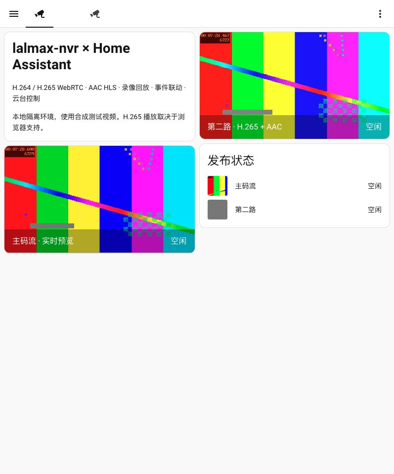

# Home Assistant

Publish selected lalmax-nvr streams as Home Assistant camera entities, with live video, snapshots and availability. HA reads RTSP from the NVR, reusing existing ingest. Publishing does not start recording or connect HA to the original camera.

## Installation

1. Copy the complete repository directory `custom_components/lalmax_nvr` into the same path under your HA configuration directory. Restart HA. The tested version is **Home Assistant 2026.10.2**. Use HA **2026.10.2 or newer**. Alternatively, extract the `lalmax_nvr.zip` CI/release asset directly into `custom_components/lalmax_nvr` (the ZIP contains `manifest.json` at its root). This is a custom integration, not built into HA.
2. Open **NVR Settings → Home Assistant**, enable publication, select streams and save. Search and bulk selection are supported. Stream cards also have individual publication buttons. Unregistered push streams can be published without creating camera devices.
3. Optionally enter an RTSP server origin such as `rtsp://192.168.1.20:15544`, without credentials or a stream path. Otherwise the media engine URL is used. The HA client replaces advertised loopback hosts with the NVR HTTP hostname. With a separate media engine, explicitly configure its reachable address.
4. In HA, use **Settings → Devices & services → Add integration → lalmax-nvr**. Enter the NVR HTTP URL, username and password. A dedicated ordinary NVR user is sufficient for reads.
5. If `media.rtsp_auth_enable` is enabled, enter the RTSP username and password separately. HTTP and RTSP credentials are independent. RTSP uses TCP and supports Basic/Digest authentication.
6. Add the resulting camera entities to your dashboard:

```yaml
type: picture-entity
entity: camera.front_door
camera_view: live
```

## Lifecycle and authentication

The integration fetches the complete catalog every 30 seconds, without the ordinary stream list's 100-item page limit. New publications create entities automatically. Offline streams retain identity and recover when the same stream returns. Identity and publication settings are persisted in the NVR database and survive restarts, reloads and database backups. Do not connect two simultaneously running database clones to the same HA as separate instances: they share an instance UUID.

Unpublishing or disabling publication makes the entity unavailable on the next refresh and stops its HA stream worker. Entity registry records remain available for manual cleanup. Republishing restores the same entity. Deleting a source leaves a selected offline publication; deselect it explicitly when permanent removal is intended.

NVR HTTP authentication is required for all integration APIs. Publication changes require a super administrator. The catalog excludes upstream camera URLs/passwords and RTSP account credentials. When `auth.playback_tokens` is configured, the catalog includes each published stream's playback token in its RTSP URL; protect it as a media credential and do not publish it in logs. Streams without a configured token remain unavailable without breaking other entries.

Unpublishing does not invalidate RTSP credentials held by other clients or grant strict per-stream isolation to an NVR user. Existing media authorization remains in effect.

## Snapshots and compatibility

H.264 video and AAC audio are the primary targets. HEVC/AAC is tested through RTSP, HA snapshots, HA HLS (advertising `hvc1`) and recorded MP4, preserving the source codecs. Playback devices still need HEVC decoding; support is not guaranteed in every browser. Publish an H.264 substream for broader compatibility. No automatic transcoding is provided.

NVR snapshots require FFmpeg on PATH and cache frames for 10 seconds. Without NVR FFmpeg, HA uses its Stream integration to generate still images. Stream snapshots never substitute an unrelated camera's image just because it has a management binding.

Check HTTP and RTSP connectivity separately. A successful HTTP configuration flow does not verify RTSP authentication. A snapshot response of 503 means FFmpeg is absent or the frame cannot currently be captured. Verify published/online status, codec, RTSP credentials and per-stream playback tokens when live playback fails. IPTV sources must first enter the lalmax media engine.

Use the HA integration's **Reconfigure** menu to change address or credentials. Invalid HTTP credentials trigger reauthentication. Reconfiguration to a different NVR identity is rejected.

| Method | API path | Purpose |
|---|---|---|
| GET / PUT | `/api/settings/home-assistant` | Read settings / completely replace publication settings (admin) |
| PUT | `/api/integrations/home-assistant/streams/{stream_id}` | Select/unselect a stream with `{"enabled":true}` or `false` (admin) |
| GET | `/api/integrations/home-assistant` | Complete published catalog, instance ID and snapshot capability |
| GET | `/api/integrations/home-assistant/streams/{stream_id}/snapshot` | Published stream JPEG |

HACS packaging and installation notes are below. Track implementation and validation in [Issue #46](https://github.com/lalmax-pro/lalmax-nvr/issues/46).


## Detection events and automations

Each published stream has an Activity event entity and Motion, Person and Vehicle binary sensors. Events arrive over an authenticated SSE connection. The NVR checks the current publication list for every event, including camera-to-stream bindings. Only normalized event types and detection labels are forwarded; arbitrary metadata, messages and filesystem paths are excluded.

The AI webhook/browser detector supplies `ai_detection` labels. `motion` labels and MQTT trigger action `motion` drive the Motion sensor; people and vehicles drive their respective sensors. The integration consumes existing detections; it does not perform inference. Configure the detector or MQTT ingress in the NVR first. Detection sensors reset 60 seconds after the last matching detection and clear on disconnection or unpublication. A sensor indicates a recent detection, not continuous occupancy.

Use HA event-entity triggers or the `lalmax_nvr_event` bus event. For example:

```yaml
triggers:
  - trigger: event
    event_type: lalmax_nvr_event
    event_data:
      stream_id: front-door
      type: ai_detection
conditions:
  - condition: template
    value_template: "{{ 'person' in trigger.event.data.labels }}"
actions:
  - action: light.turn_on
    target:
      entity_id: light.entrance
```

Events include `instance_id`, `config_entry_id`, `stream_id`, `id`, `type`, `source`, `started_at` and `labels`. Filter by instance or config entry when multiple NVRs use the same stream ID. Types are `ai_detection`, `motion`, `mqtt_trigger`, `recorder_reconnected` and `health`. The connection reconnects with bounded backoff; event entities become unavailable during interruptions. This is a live feed with duplicate suppression, not durable delivery: events during disconnections are not replayed. Historical events remain in the NVR event timeline. Reverse proxies must forward `/api/integrations/home-assistant/events` without response buffering and permit long-lived connections.


## Recordings in the media browser

Open **Media → lalmax-nvr recordings → NVR instance → published stream** in Home Assistant. Recordings are listed newest first, 100 per page. Only completed MP4 clips are offered; the NVR needs an enabled recording plan to create them. Publishing a stream alone never starts recording. Offline streams can still have playable historical clips.

HA proxies playback using a temporary signed HA URL; NVR account credentials and filesystem paths are never placed in the playback URL. The proxy streams chunks and forwards byte ranges and HEAD requests for seeking. Each new read rechecks publication and recorded-stream ownership at the NVR, so unpublishing immediately blocks new reads through a previously signed URL. A transfer already in progress may finish. Deleting/archiving clips makes them unavailable. Old records without a stream ID are recognized only when their camera ID equals the published stream ID.

H.264/AAC MP4 is tested. H.265 MP4 still depends on the playback device; MJPEG directories and raw recordings are not exposed as video clips. This feature browses existing recordings and does not request transcoding. Play a media-source identifier in HA automations using the media browser's selected clip.


## PTZ controls

A published stream bound to an ONVIF or GB28181 camera exposes seven native HA buttons (left/right/up/down, zoom in/out, stop). The NVR HTTP account must be a super administrator for movement; a read-only account can still use video, events and recordings. Use HA Reconfigure to change the account when control is needed. Lack of control permission produces an action error, not a reauthentication flow.

The `lalmax_nvr.ptz` action targets a camera entity, with `mode` (`continuous`, `relative`, `absolute`, `stop`, `goto_preset`), normalized `pan`, `tilt`, `zoom`, optional `preset_token`, and `duration` (0.1–5 seconds, default 0.5). Absolute zoom is 0–1. `lalmax_nvr.ptz_presets` returns the ONVIF preset list and requires an action response. GB28181 supports single-axis continuous pulses and stop; relative/absolute/preset actions are rejected.

NVR performs the automatic stop for continuous movement, including caller disconnection and publication revocation during the pulse. A failed move or stop returns an error; network/device failures can prevent physical stopping. New commands check current publication and camera binding. The integration advertises protocol support, not a guarantee that every ONVIF camera implements PTZ. Real HA testing uses loopback ONVIF SOAP and authenticated GB28181 SIP protocol simulators; physical hardware has not been tested.


## Optional low-latency WebRTC

Enable the low-latency option in HA Reconfigure. Online published H.264 and H.265/HEVC streams then offer both WebRTC and HLS to HA's player. The option defaults to off. HEVC WebRTC requires browser negotiation and decoding support. Offers without the source codec are rejected; disable low latency to use HLS, or publish an H.264 substream. Current WebRTC playback does not carry AAC audio; use HLS for audio. No transcoding is started.

HA negotiates WHEP through authenticated NVR endpoints. Media travels directly between the viewer and engine over ICE, so the viewer must reach the engine's advertised UDP addresses and ports. Actual H.264/HEVC reception and decoding are tested with candidate-free offers over direct connections and forced authenticated TURN/UDP relays configured through HA's `web_rtc` component. Supply your own TURN service; the controlled local relay test does not establish real public NAT compatibility.

To use an existing TURN service, configure HA's `configuration.yaml` and restart HA. Replace the placeholders and keep credentials out of version control:

```yaml
web_rtc:
  ice_servers:
    - url: ["turn:turn.example.com:3478?transport=udp"]
      username: "your-turn-user"
      credential: "your-turn-password"
```

Closing a viewer, unloading the integration or withdrawing a publication cleans up its sessions. A signed cleanup token remains usable after withdrawal only to delete the original session. Tokens are scoped to the stream, instance and configured engine origin, expire in 24 hours and become invalid after an NVR restart. Abnormal termination also relies on engine timeout cleanup.


## Final demonstration

Captured after the complete integration and release tests, using NVR V1.0.2 and HA integration 0.6.1 on isolated HA 2026.10.2. Video is synthetic test input; PTZ uses ONVIF/GB28181 protocol fixtures. These are actual application screenshots.



[Detection events and PTZ](../images/home-assistant/events-ptz.png) · [HEVC recording playback](../images/home-assistant/recording.png) · [NVR publication settings](../images/home-assistant/publication.png)

Release validation: [complete build and seven assets](https://github.com/lalmax-pro/lalmax-nvr/actions/runs/39884373628), [duplicate publication skipped](https://github.com/lalmax-pro/lalmax-nvr/actions/runs/39884376124), and [published binary/FFmpeg runtime on all three Docker architectures](https://github.com/lalmax-pro/lalmax-nvr/actions/runs/39886532867). The GHCR package is public. Anonymous `docker pull ghcr.io/lalmax-pro/lalmax-nvr:1.0.2` and execution of the downloaded container were verified with an empty Docker credential configuration.

## HACS packaging and distribution

This repository follows the HACS single-integration layout and includes `hacs.json`, with HA 2026.10.2 as the tested minimum. The integration has its own version in `manifest.json`; it is independent of the NVR binary version. HACS official catalog inclusion and Home Assistant Brands review are external steps and have not been completed.

The Home Assistant CI workflow builds `lalmax_nvr.zip` as an artifact after tests. NVR tag releases attach this ZIP. To package locally:

```sh
python scripts/package_home_assistant.py --output /tmp/lalmax_nvr.zip
```

For a separate HA-only repository, add `--export-dir /tmp/lalmax-nvr-home-assistant` (a new directory). The export contains only the integration, HACS metadata, installation guides and license. It does not publish or create repositories. This avoids mixing NVR binary release versions with HA integration updates.

Keep distribution in this main repository. In HACS, open **⋮ → Custom repositories**, add `https://github.com/lalmax-pro/lalmax-nvr` with type **Integration**, open the repository and download the latest stable release. Restart HA, then configure **lalmax-nvr** under **Settings → Devices & services**. Use releases **V1.0.1 or newer**; V1.0.0 predates this integration.

Actual UI first installation of **V1.0.2** was tested with HACS 2.0.5 / HA 2026.10.2. A separate HA instance upgraded through HACS from **v1.0.1-rc.1** to **V1.0.2**, preserving all 24 entity IDs, unique IDs and config entry IDs. Both tags contain integration version 0.6.1; this validates the repository release upgrade path. HACS GitHub authentication was preconfigured; interactive GitHub device authorization was not part of this test. The tested installation supports live media, snapshots, events, recordings and protocol-simulated PTZ.

To leave prereleases, turn off the repository's beta switch entity and select the stable release in **Redownload → Need a different version?** if necessary. Restart HA after downloading an update. HACS 2.x displays the repository README; `info.md` does not replace it.

References: [HACS integration structure](https://www.hacs.dev/docs/publish/integration/), [repository manifest](https://www.hacs.dev/docs/publish/start/#hacsjson).
