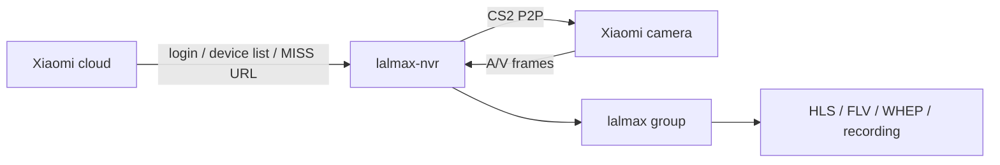
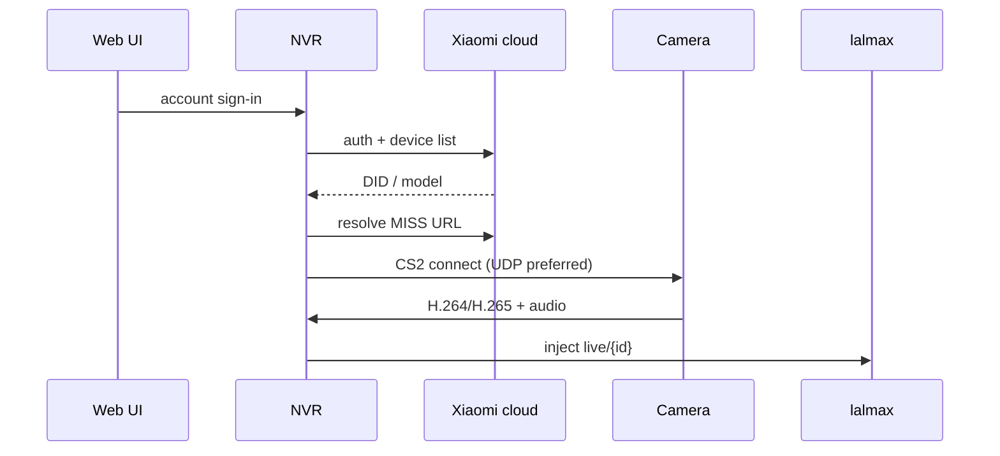

# Xiaomi Camera Integration

lalmax-nvr provides comprehensive support for Xiaomi cloud cameras through the CS2 P2P protocol. Video and audio frames are injected into lalmax, then played as WebRTC, HLS, HTTP-FLV, and the rest.





This is **P2P fetch then inject**, not RTSP pull and not GB28181 publish. Overview: [Architecture](architecture.md).

## Overview

- **Protocol**: CS2 and TUTK P2P (Xiaomi's proprietary cloud protocol)
- **Authentication**: Xiaomi cloud services with token-based auth
- **Supported Models**: MISS cameras (see table below)
- **Features**: Live streaming, recording, two-way audio, directional PTZ
- **Transport**: CS2 over UDP or TCP, and TUTK over UDP

## Prerequisites

- Xiaomi account with registered cameras
- Cameras bound to your Xiaomi account in Mi Home app
- Network access to camera's LAN IP from NVR

## Supported Camera Models

| Model | Identifier | Encoding | Audio | Notes |
|-------|------------|----------|-------|-------|
| **Xiaomi C200** | `chuangmi.camera.046c04` | H264 | PCMA | HD 1080p indoor camera |
| **Xiaomi C300** | `chuangmi.camera.72ac1` | H265 | Opus | 2K indoor camera |
| **Xiaofang** | `isa.camera.isc5c1` | H264 | PCM | Pan/tilt dome camera |
| **Xiaomi HLC8** | `isa.camera.hlc8` | H265 | PCMA | Dual-lens camera |
| **Loock V2** | `loock.cateye.v02` | H264 | PCMA | Smart doorbell camera |
| **Dafang** | `isa.camera.df3` | - | - | MISS firmware may work; legacy firmware is not supported |

**Important**: MISS devices using CS2 or TUTK transport are supported. Legacy login and media protocols are not yet supported. TUTK requires hardware verification.

## Features

- **Live Preview**: WebRTC, HLS, HTTP-FLV playback
- **Recording**: Automatic MP4 segment recording
- **Audio**: G.711 (PCMA/PCMU) and Opus audio codecs
- **Audio sample rate**: Received 16 kHz G.711/PCM is low-pass filtered and resampled to the downstream 8 kHz rate; Opus retains its encoding.
- **Pan/Tilt**: Direction, speed and stop controls for motor-equipped models.
- **Two-way Audio**: Send audio to camera speaker via WebSocket
- **Dual-lens Devices**: Uses the default lens; main/secondary channel selection is not exposed in configuration or the UI yet
- **Auto Fallback**: HD to SD fallback when the first video frame times out, including audio-only connections

## Setup Methods

### Web UI Setup (Recommended)

1. **Access Web UI**: Open lalmax-nvr Web Interface at `http://localhost:9090`

2. **Navigate to Cameras**: Go to the Cameras page

3. **Xiaomi Discovery**: Expand the "Xiaomi Device Discovery" section

4. **Authenticate**: Select the same account region as Mi Home, enter your Xiaomi account credentials and click "Sign In"
   - If captcha/2FA is required, follow the prompts

5. **Select Devices**: Browse the discovered devices and select cameras you want to add

6. **Add to NVR**: Click "Add to NVR" for each selected camera

7. **Configure**: Customize settings for each camera (retention, quality, etc.)

8. **Save**: Click "Save Configuration" to apply changes

An account with no cameras stays signed in. Device refresh errors are shown without discarding the account controls. Sign Out removes persisted server credentials and pending captcha/2FA challenges; a failed save retains the signed-in state and displays an error. Camera configurations remain available. Existing streaming connections continue until disconnected; reconnecting then requires signing in again.

A wrong verification code or temporary network failure can be retried in the current login session. Sessions expire after 10 minutes, after which login must restart. Credentials are applied to running cameras only after the configuration is saved successfully; persistence failures are reported as errors.

### Manual Configuration

Named accounts can be configured in the YAML file and selected in device discovery:

```yaml
xiaomi:
  user_id: "default-user-id"
  token: "default-token"
  region: "cn"
  accounts:
    home:
      user_id: "other-user-id"
      token: "other-token"
      region: "sg"
```

Named account credentials are currently added and updated in the configuration file. Use `xiaomi://device-id?account=home` to bind a camera to that account; omitting `account` selects the default account. Named user IDs and tokens use the existing configuration encryption mechanism when enabled.

Edit the configuration file:

```yaml
xiaomi:
  user_id: "123456789"
  token: "your_passToken_here"
  region: "cn"

cameras:
  - id: "xiaomi_c200_front"
    name: "Xiaomi C200 - Front"
    protocol: "xiaomi"
    encoding: "h264"
    did: "device_id_here"
    vendor: "cs2"
    enabled: true
    audio_enabled: true
```

### Configuration Options

| Field | Required | Type | Default | Description |
|-------|----------|------|---------|-------------|
| `user_id` | Yes | string | - | Xiaomi user ID (auto-filled after login) |
| `token` | Yes | string | - | Xiaomi passToken (auto-filled after login) |
| `region` | No | string | "cn" | Region code (cn, sg, de, us, etc.) |
| `did` | Yes | string | - | Xiaomi device ID |
| `encoding` | Yes | string | "h264" | Video encoding (h264, h265) |
| `audio_enabled` | No | boolean | true for H.264/H.265 | Enable audio recording; API creation can explicitly disable it |

## Pan/Tilt Control

The live-view control pad provides four directions and three speed settings. Holding a direction moves the camera; releasing, leaving the button, or leaving the view sends stop. Xiaomi controls omit optical zoom and presets.

Controls reuse the active streaming connection. Disconnected or reconnecting cameras return `503`. Motor compatibility still requires testing on the specific model.

CW400 (`isa.camera.hlc8a`) and CW500 (`isa.camera.500dh`) use fixed-step motor commands; their step size is determined by the camera and the speed setting does not alter it.

The recorder keeps an authenticated cloud session for up to 10 minutes and the device list for up to 30 seconds. A credential change or failed resolution invalidates the cached session; each connection still obtains a fresh device authorization. Doorbell models are sent a wakeup request before connection.

- `POST /api/cameras/{id}/ptz/move`: `{"mode":"continuous","pan":-0.5,"tilt":0,"zoom":0}`.
- `POST /api/cameras/{id}/ptz/stop`: no request body.

Pan and tilt are normalized to `[-1,1]`; the larger axis wins when both are set. Magnitude maps to native speeds `1–10` (approximately `3/5/10` for the three UI settings). A zero vector stops movement. Only continuous movement is supported, and zoom must be zero.

Movement expires after two seconds. Clients must renew commands to continue moving; the Web UI renews every 500 ms. The server attempts an automatic stop if a stop request is lost.

## Two-way Audio (Talk)

Set lens and quality in the camera URL, for example `xiaomi://123?channel=1&quality=sd`. `channel` accepts `0` (default lens), `1`, and `2`; the second-lens channel varies by model. `quality` accepts `hd`, `sd`, and `auto`, with `hd` as the default. These options are currently configured through the URL.

Xiaomi cameras support two-way audio, allowing you to send audio to the camera's speaker.

### Usage

1. In the live preview page, click the microphone button
2. Browser will request microphone permission
3. After granting permission, start talking
4. Click again to stop

### Supported Audio Codecs

| Camera Model | Talk Codec |
|--------------|-----------|
| Dafang, Xiaofang | PCM (16bit) |
| C300 | Opus |
| Other models | PCMA (G.711) |

### API Endpoint

```
GET /api/xiaomi/talk/ws?camera_id={camera_id}
```

After opening the WebSocket, read the server's `connected` status and `speaker_codec` before sending binary audio. Each message contains one 40 ms frame:

- `1027`: 8 kHz mono PCMA, 320 bytes per message.
- `1024`: 8 kHz mono signed PCM16LE, 640 bytes per message.
- `1032`: 48 kHz mono raw Opus, without a WebM/Ogg container.

The browser selects the encoder for the speaker codec. Opus talk requires WebCodecs AudioEncoder support; unsupported browsers show a message and release the microphone.

## Network Transport

### Transport Protocol

The system uses **UDP transport** by default for CS2 P2P communication and handles camera PING/PONG liveness probes.

### Network Requirements

- NVR must be able to reach the camera's LAN IP
- UDP port 32108 must be accessible
- Firewall must allow UDP traffic

## Troubleshooting

### Common Issues

#### "Unsupported vendor" Error
- **Cause**: Camera uses an unsupported transport
- **Solution**: Ensure your camera model is in the supported list

#### "Authentication Failed" Error
- **Cause**: Invalid credentials or account requires captcha/2FA
- **Solution**:
  - Verify Xiaomi account credentials
  - Complete captcha or phone verification if prompted
  - Check if 2FA is enabled on your account

#### Camera Not Listed
- **Cause**: Camera not bound to Xiaomi account or offline
- **Solution**:
  - Ensure camera is online and connected to Xiaomi cloud
  - Verify camera is bound in Mi Home app
  - Check network connectivity

#### Connection Drops Immediately
- **Cause**: CS2 connection issue
- **Solution**:
  - Ensure NVR and camera are on the same LAN
  - Check if UDP port is blocked by firewall
  - Check logs for specific error messages

#### WebRTC Cannot Play
- **Cause**: Browser doesn't support H265 or network issue
- **Solution**:
  - Try Safari browser (better H265 support)
  - Check browser console for errors
  - Try switching to HLS or HTTP-FLV protocol

### Logs

```bash
# View Xiaomi-related logs
grep "xiaomi" logs/lalmax-nvr.log

# View connection errors
grep "cs2:" logs/lalmax-nvr.log
```

## Technical Details

### Streaming Architecture

```
Xiaomi Camera → MISS Protocol → H264/H265 + PCMA/Opus
    ↓
CS2 P2P (UDP) → lal Media Server
    ↓
WebRTC / HLS / HTTP-FLV → Browser Playback
    ↓
RTSP Pull → MP4 Recording
```

### Supported Codecs

| Type | Codec | Notes |
|------|-------|-------|
| Video | H.264 | Most models |
| Video | H.265 | C300, HLC8, newer models |
| Audio | G.711 PCMA | Most models |
| Audio | G.711 PCMU | Some models |
| Audio | Opus | C300 and newer models |

## API Reference

### Authentication

- `POST /api/xiaomi/auth` - Login with Xiaomi account
- `POST /api/xiaomi/captcha` - Submit captcha code
- `POST /api/xiaomi/verify` - Submit 2FA verification
- `GET /api/xiaomi/status` - Read saved account status and region without contacting the cloud; credentials are never returned
- `POST /api/xiaomi/logout` - Remove saved/runtime credentials and pending login challenges (administrator permission required)

### Device Management

- `GET /api/xiaomi/devices` - List discovered devices
- `POST /api/xiaomi/sync` - Sync device info from cloud
- `GET /api/xiaomi/check-vendor?did={did}` - Check device compatibility

### Streaming

- `POST /api/cameras/{id}/stream/webrtc` - Start WebRTC playback
- `GET /api/xiaomi/talk/ws?camera_id={id}` - Two-way audio WebSocket

## Support

For additional help, see [Getting started](getting-started.md) or create an issue on the GitHub repository.
