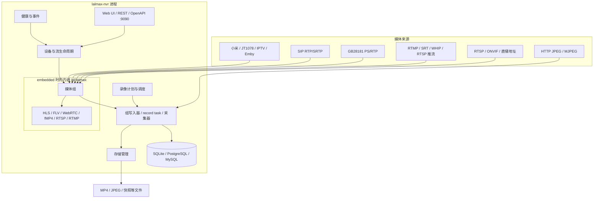
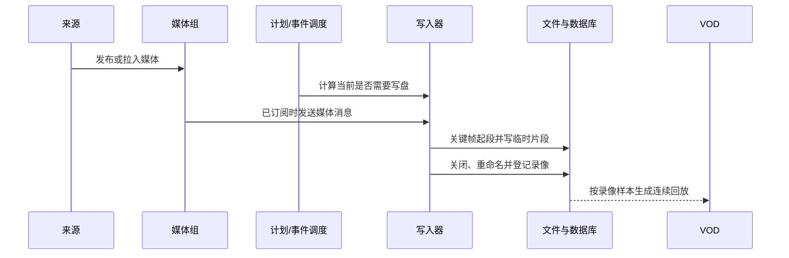

# NVR-01 系统架构规范

## 1. 目的与范围

本文规定 lalmax-nvr 当前代码中的进程边界、核心对象、媒体与录像数据流、模块职责和默认端口。设备级操作见对应专题；录像内部调用细节见[录制流程](recording-flow.md)。

## 2. 架构边界

**ARCH-001｜业务与媒体分离。** NVR 负责设备、用户、策略、索引、文件和业务 API；lal/lalmax 负责媒体接入、组分发和协议转换。二者在 `embedded` 模式下同进程运行，但不是同一职责层。

**ARCH-002｜统一媒体组。** 支持进入 lal/lalmax 的来源应汇入以 `stream_id` 定位的媒体组。直播协议和嵌入式录像订阅应复用该组，避免为每个消费者重复拉取同一设备源流。

**ARCH-003｜例外必须显式。** HTTP JPEG、MJPEG 的特定采集路径和延时摄影不强制经过 lalmax；IPTV 仅浏览器代理播放时也不进入媒体组。文档不得把所有来源描述为同一种拉流路径。

**ARCH-004｜元数据与媒体文件分离。** 数据库存储设备、用户、计划、事件和录像索引；媒体文件存储在文件系统。数据库备份不等于完整录像备份。



## 3. 核心对象与标识

| 对象 | 标识 | 职责 | 不承担的职责 |
|------|------|------|--------------|
| Camera / 设备 | `camera_id` | 设备凭据、能力、位置、生命周期和展示 | 存在本身不触发录像 |
| Stream / 流 | `stream_id` | 媒体发布、订阅、播放和计划绑定 | 不一定有对应设备 |
| 媒体组 | 通常为 `live/{stream_id}` | lal/lalmax 内的一路实时媒体 | 不等同于录像文件 |
| RecordingPlan | `id`，且 `stream_id` 唯一 | 决定某条流当前是否写盘 | 不决定设备是否上线 |
| Recording | `id`、`camera_id`、`stream_id` | 已落盘媒体的索引和时间信息 | 不替代实际媒体文件 |

**ARCH-101｜设备与流解耦。** 纯推流或纯计划流可以没有设备；设备通过 `stream_id` 绑定流。设备的 `stream_id` 为空时通常使用 `camera_id`，非空时使用指定值。

**ARCH-102｜录像来源归属。** 有设备归属时，录像的 `camera_id` 使用设备 ID；纯流录像可使用流 ID 作为来源 ID。查询历史录像时应使用录像来源接口返回的 ID，不能假定所有 `camera_id` 都仍存在于设备表。

**ARCH-103｜子码流独立。** 预览子码流是独立流，不继承主流录像计划。常见命名为 `{camera_id}_sub`，但客户端必须使用 API 返回的实际流和 URL。

## 4. 媒体引擎模式

| 规则 | `embedded` | `http` |
|------|------------|--------|
| 引擎位置 | 与 NVR 同进程 | 外部 lalmax，经 HTTP 适配器访问 |
| 默认内部控制地址 | `http://127.0.0.1:12090` | `media.lalmax_http_addr` |
| H.264/H.265 录像 | 优先组订阅；特定路径使用 record task | 通过 record task 拉取媒体 |
| IPTV/Emby HLS 发布、VoIP、SFU 等 | 支持受当前代码约束的能力 | 部分能力明确不可用 |
| 适用部署 | 默认和推荐方式 | 需要外置媒体引擎的定制部署 |

**ARCH-201｜外部地址与内部地址分离。** `media.lalmax_http_addr` 用于 NVR 访问引擎；`media.lalmax_public_url` 用于生成客户端可访问的 URL。后者不得在对远程客户端提供服务时保留为不可达的回环地址。

**ARCH-202｜能力以运行响应为准。** `GET /api/streams/{stream_id}` 和流列表返回的 `play_urls`、`ingest_urls` 是当前配置和编码下的可用地址。文档中的 URL 模板不能替代运行时发现。

## 5. 接入方向

| 来源 | 控制/信令 | 媒体方向 | 说明 |
|------|-----------|----------|------|
| RTSP | 可选 ONVIF 管理 | NVR 主动拉流 | RTSP transport 默认 TCP |
| ONVIF | WS-Discovery、SOAP、`GetStreamUri` | 获取地址后通常经 RTSP 拉流 | ONVIF 负责设备能力，不是媒体封装 |
| GB28181 | 设备 REGISTER；平台 Catalog / INVITE | 设备向 `media_ip` 推 PS/RTP | NVR 是 SIP 上级平台 |
| RTMP / SRT / WHIP | 编码器建立发布会话 | 编码器主动推流 | 必须按协议配置发布认证 |
| SIP VoIP | 终端注册/呼入，或 NVR 经 PBX 外呼 | RTP/SRTP 桥接为 NVR 流 | 与 GB28181 对讲是不同服务 |
| 小米 | 云认证和厂商传输 | NVR 获取帧后注入媒体引擎 | 社区驱动，型号能力有差异 |
| JT1078 / JT808 | 可选 JT808 信令 | 终端经 TCP/UDP 推送 JT1078 | 实验性；真实终端验证有限 |
| IPTV | M3U 导入与探测 | 浏览器代理或 NVR 服务端 HLS 拉流 | 两种播放路径不得混淆 |
| Emby | Emby API | NVR 获取 HLS 并发布为实时流 | 片尾下线或按配置循环 |

## 6. 录像数据流

**ARCH-301｜接入与写盘解耦。** 流在线、组订阅存在和正在写盘是三个不同状态。停止录像不应被等同于停止直播拉流。

**ARCH-302｜计划是唯一常规策略源。** 无计划、计划禁用或 `off` 均不写盘；`promote`（登记为设备）不创建计划。

**ARCH-303｜嵌入式组写入。** 对组写入器覆盖的流，`GroupWriter` 保持订阅，计划调度通过写开关控制落盘。`adaptive`、HTTP 模式和不被组写入器覆盖的路径使用 record task 或专用采集器。

**ARCH-304｜片段完成后可索引。** 写入临时对象、关闭封装、原子重命名、写入录像索引构成片段收尾流程。新 MP4 段在关键帧边界开始，目标时长到达后在后续关键帧切分。



计划模式、清理和回放规则见[录像与回放](recording-plans.md)。

## 7. 模块职责

| 路径 | 职责 |
|------|------|
| `cmd/lalmax-nvr` | CLI、依赖组装、启动与停止顺序、顶层 HTTP 路由 |
| `internal/api` | REST、媒体代理、SSE/WebSocket 业务入口 |
| `internal/config` | YAML 加载、默认值、校验、保存、加密与变更检测 |
| `internal/camera` | 设备启停、拉流协调、录像路径选择 |
| `internal/media` | embedded/http 引擎适配、播放 URL、流事件、推流接入 |
| `internal/recorder` | 计划、调度、组写入器、record task 和专用采集器 |
| `internal/storage` | 数据库、录像索引、文件生命周期和路径编码 |
| `internal/merge` / `internal/vod` | 片段合并、连续 HLS fMP4 回放 |
| `internal/event` / `internal/health` | 事件总线、持久化、健康检测和修复 |
| `internal/onvif` + `onvif/` | NVR 侧 ONVIF 适配和独立 ONVIF 协议库 |
| `internal/gb28181` / `internal/voip` / `internal/jt808` | 三类独立信令与设备业务 |
| `internal/iptv` / `internal/emby` | 外部内容源管理和发布 |
| `internal/transcode` / `internal/relay` | 可选转码任务与中继 |
| `internal/ui` + `web/` | 内嵌静态资源和 Svelte 前端源码 |
| `internal/docsportal` | 内嵌 OpenAPI 页面和规范文件 |
| `third/lal` / `third/lalmax` | vendored 媒体引擎及本地扩展 |

## 8. 默认端口与暴露条件

| 端口 | 协议 | 用途 | 默认状态/条件 |
|------|------|------|---------------|
| `9090/tcp` | HTTP | Web UI、API、OpenAPI、WebDAV | 主监听；WebDAV 可单独关闭 |
| `12090/tcp` | HTTP | lalmax 控制、LL-HLS、WHEP/WHIP、fMP4 等 | embedded 媒体 HTTP |
| `4888/udp,tcp` | ICE | WebRTC ICE mux | 使用 WHIP/WHEP 且客户端需要直连时 |
| `15544` | RTSP | RTSP 播放/发布能力 | 媒体引擎配置生效时 |
| `18080/tcp` | HTTP | lal HLS-TS、HTTP-FLV 等 | 媒体引擎配置生效时 |
| `11935/tcp` | RTMP | RTMP 推流 | `rtmp.enabled=true` |
| `19000/udp` | SRT | SRT 推流 | `srt.enabled=true` |
| `1078/tcp,udp` | JT1078 | 车载媒体接收 | embedded 生成配置默认开启；实验性 |
| `808/tcp` | JT808 | 车载终端信令 | `jt808.enabled=true` |
| `5060/tcp,udp` | SIP | GB28181 信令 | `gb28181.enabled=true` |
| `5070/udp` | SIP | VoIP 默认 UDP 监听 | `voip.enabled=true` |
| `41000–42000/udp` | RTP/SRTP | VoIP 媒体 | `voip.enabled=true` 的默认范围 |
| `2121/tcp` + 被动范围 | FTP | 存储文件访问/上传 | `ftp.enabled` 默认 true；不建议公开暴露 |
| `8200/tcp` | HTTP | DLNA 媒体资源 | `dlna.enabled=true` |
| `1900/udp` | SSDP | DLNA 发现 | DLNA 启用且需要组播发现 |

**ARCH-401｜按需开放。** 开放 Web/API 端口不意味着必须开放整张端口表。部署者应只映射正在使用且已配置认证的协议。

**ARCH-402｜媒体接收地址可达。** GB28181 `media_ip`、VoIP 的 SIP/RTP 通告地址、WebRTC ICE 地址必须是远端设备实际可达地址，不能仅配置监听端口。

## 9. 存储布局

默认 SQLite 数据库为 `{storage.root_dir}/lalmax-nvr.db`。录像文件直接位于存储根下按录像来源编码的目录中，并不存在统一的 `recordings/{encoding}/{camera_id}` 层级：

```text
{storage.root_dir}/
├── lalmax-nvr.db              # 默认 SQLite；使用外部数据库时仍保留其他文件
├── config/lalmax.conf.json    # 默认生成的内嵌媒体引擎配置
├── {encoded-source-id}/       # MP4 或 MJPEG 片段/合并文件
├── snapshots/                 # 快照功能产生的文件（按实际功能）
└── backups/                   # 配置位于数据根时，API 数据库备份默认在此
```

简单 ASCII 来源 ID（字母、数字、`-`、`_`）保留原名；其他 ID 使用可逆的 `id~` 十六进制编码，Windows 保留名也会编码。文件路径应以数据库记录和存储管理器为准，不应自行拼接未编码的 `camera_id`。

## 10. 成熟度与非承诺

- JT1078/JT808 和 SFU 属于实验能力；不得把模拟器或自动化测试描述为所有真实设备均已兼容。
- 实时转码默认关闭，依赖运行机上的 FFmpeg/GStreamer 能力和显式任务配置。
- 浏览器能否播放 H.265、音频或特定 WebRTC 组合还取决于浏览器与终端能力。
- 当前实现限制应写在对应专题中；历史设计稿中的目标、路线图或性能数字不构成当前保证。
