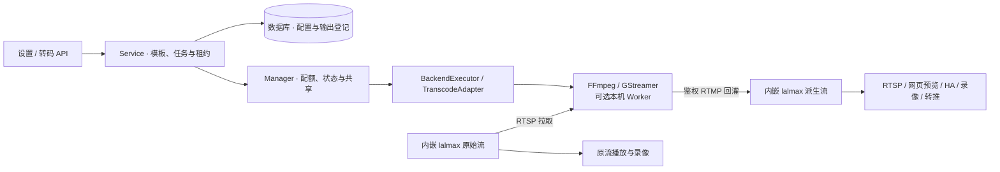

# 通用实时转码架构设计

- 初稿：2026-10-26
- 实现说明更新：2026-11-13
- 跟踪 Issue：[通用实时转码 #66](https://github.com/lalmax-pro/lalmax-nvr/issues/66)；本地正文备份见 [Issue 草稿](https://github.com/lalmax-pro/lalmax-nvr/blob/849198a0c9d4b5d9c00aef171c8bbf1e55f2d170/docs/zh/transcoding-tracking-issue.md)
- 背景关联：[Home Assistant 集成 #46](https://github.com/lalmax-pro/lalmax-nvr/issues/46)
- 范围：通用实时媒体转码，FFmpeg / GStreamer 可替换后端，本地与 Docker 部署。

部署、启停与配置示例见[部署指南](transcoding-deployment.md)，各场景证据见[验收记录](transcoding-testing.md)。第 3 至 5 节描述当前实现，后续章节保留原始设计和阶段目标。

## 1. 背景与定位

转码是 NVR 的通用媒体基础能力，不属于 Home Assistant 专用功能。NVR 网页、HA、外部播放器、录像和转推都可以消费同一派生输出。HA 仅作为首批消费者，不拥有转码进程，也不决定其生命周期。

当前源码基线：

- [媒体引擎接口](../../internal/media/types.go) 已提供流查询、播放地址、事件订阅和自定义发布能力。
- [主 Dockerfile](../../Dockerfile) 已安装 FFmpeg；[独立 ARM64 Dockerfile](../../Dockerfile.arm64) 使用 scratch，不含它，需核实该构建入口的保留策略。
- [快照实现](../../internal/api/handlers_snapshot.go) 通过 PATH 查找 FFmpeg，尚无统一可执行路径配置。
- 转码配置意图、派生输出登记与录像来源分别持久化。[转码配置存储](../../internal/storage/db_transcoding.go)、[派生输出存储](../../internal/storage/db_transcode_outputs.go)、[派生录像来源](../../internal/storage/db_transcode_recording_sources.go)。
- HA 发布可引用源流下的一个派生任务。[HA 目录](../../internal/api/handlers_home_assistant.go)、[WHEP API](../../internal/api/handlers_home_assistant_webrtc.go)和 [HA 实体](../../custom_components/lalmax_nvr/camera.py)使用稳定源身份。
- [WHEP 音频实现](../../third/lalmax/rtc/whepsession.go) 支持 PCMA、PCMU、Opus；不能将 H.264/AAC 输出等同于 WebRTC 有声兼容。

## 2. 目标与非目标

### 目标

1. 统一管理转码模板、任务、派生输出及消费者需求。
2. FFmpeg 默认后端；GStreamer 可选后端，共享调度与鉴权模型。
3. 原流不变、默认不转码，支持视频转码、音频转码、降分辨率、降帧率和码率控制。
4. 同源同模板共享任务，具备资源限额、故障恢复、日志和运行状态。
5. 支持本地路径配置、同容器运行；为硬件加速与独立 worker 保留接口。
6. 消费者按权限选择原始流或派生输出，源身份不因输出切换而改变。

### 首版非目标

- 任意命令、任意 pipeline 编辑器或任意远程输入 URL。
- 历史录像离线转码、自动改写已有录像。
- 完整 ABR 自适应码率协议、多档输出自动共享一次解码。
- 无条件跨后端/硬件到软件降级、分布式 GPU 调度。
- 所有协议均支持按需启动，或所有平台均已验证硬件加速。

## 3. 架构与职责



- `Service` 校验模板修订和任务代次，检查能力检测结果，协调常驻、手动与按需策略。`Manager` 依据生效参数共享工作、分配并发额度、检查首帧和媒体健康。[Service](../../internal/transcode/service.go)、[Manager](../../internal/transcode/manager.go)。
- 执行器由 `SourceRef` 在内嵌引擎查找源，构造受信 RTSP 输入和受保护的 RTMP 回灌地址。后端运行固定模板，进程启动后仍需等待派生组出帧才进入 `running`。[执行器](../../internal/transcode/executor.go)、[媒体适配器](../../internal/media/transcode_adapter.go)。
- 派生组 ID 每次新建执行时随机生成。启动前登记身份，停止先撤销凭据再清理媒体组，重启时恢复历史组的拒绝标记。播放解析器用源 ID、任务 ID、运行状态及实际媒体判断是否发放播放地址。[播放解析](../../internal/api/transcode_playback_resolver.go)。
- 独立 Worker 通过私有 stdin 接收一次性 HMAC 签名的启动参数。Worker 与 NVR 使用同一 OS 用户，父进程管道关闭触发后端回收。[Worker](../../internal/transcode/worker.go)。

## 4. 数据模型

| 对象 | 关键字段 | 说明 |
|---|---|---|
| SourceRef | stream_id、engine_id、app_name | 引用已有逻辑源，由服务端解析实际地址 |
| Profile | id、revision、backend、video、audio | 保存目标媒体规格 |
| Job | id、source、profile_id、profile_revision、enabled、run_policy、generation、stopped_by_user | 保存运行意图与显式停止标志 |
| Variant | id、source_id、job_id、profile_id、generation、state、error_code、retry_at | 对消费者公开的稳定逻辑输出 |
| DemandLease | token、job_id、generation、expires_at | 内存中的消费需求，租约默认 90 秒，可续期 |
| Runtime | key、variant_id、state、error_code | 进程内运行状态，此处的 variant_id 是本次执行的物理流 ID |

去重键为 `(engine_id, app_name, stream_id, effective_profile_hash)`。有效规格包含后端和音视频参数，模板名和修订号不参与计算。等价任务共享一个进程和物理输出，最后一个运行需求结束后释放资源。不同规格各自运行编码任务。

派生流需登记可信来源映射，不能仅根据字符串前缀判定内部身份。默认禁止派生输出作为转码源，避免递归和环；未来开放处理图时必须检测环。

### 持久化

数据库保存模板、任务、物理输出身份和派生录像来源。任务引用模板时，修改或删除该模板会返回冲突。升级及回退边界见 [P0 决策记录](transcoding-p0-decisions.md#存储迁移与回退)。

配置更新使用 revision/generation 防止旧进程退出事件覆盖新任务状态。首版模板更新可停止旧任务再启动新任务，明确短暂断流；无缝切换不作为首版承诺。

## 5. 控制面、状态机与生命周期

运行策略：

- `always` 在任务启用且源可用时由后台启动。重启后重新验证模板，失败按退避间隔重试。显式停止后保留停止标志。
- `manual` 由操作员显式启停，重启后须再次启动。
- `on_demand` 通过有效租约启动，最后一个租约释放或过期时回收该任务的运行需求。显式停止会清除该任务的租约。

任务运行状态：

```text
disabled / stopped --启用且有运行需求--> starting --派生组持续出帧--> running
starting / running --后端或媒体故障--> failed
failed --常驻任务或有效租约--> backoff --达到重试时间--> starting
starting / running --停止、删除或服务退出--> stopping --> stopped
```

手动启动超出配额时返回 `capacity_exceeded`。后台重试延迟从 5 秒逐步增至 60 秒。进程归属于 NVR 服务生命周期，共享工作持续到最后一个任务释放运行需求。停止时回收后端进程与媒体会话，重启后根据数据库中的配置重新协调。

### 按需启动的协议边界

网页派生预览负责获取、续期和释放租约。租约接口可用 `wait_ms` 等待首帧，最长 20 秒。HA 可在发布配置中启用 `preload_transcode`，由 NVR 保持租约。外部播放器、录像和转推消费已经运行的派生流。直接拉取播放地址不会创建租约。

## 6. 后端接口与媒体链路

建议新增 `internal/transcode` 包，核心接口示意：

```go
type Backend interface {
    Probe(ctx context.Context) (Capabilities, error)
    Start(ctx context.Context, spec JobSpec) (Process, error)
}

type Process interface {
    Wait() error
    Stop(ctx context.Context) error
}
```

`JobSpec` 表达统一输入输出和媒体要求，不传公共 `FFmpegArgs`。后端专用选项经过白名单和范围验证。首版以固定模板生成命令，不允许普通用户提交任意命令或 pipeline。

### FFmpeg

使用可执行路径配置和参数数组启动子进程，不经 shell。统一路径解析可供快照、延时摄影使用，但持续转码与短时抽帧的超时/配额不能混用。显式路径无效直接报错，未配置时查找 PATH。

### GStreamer

初期可使用 `gst-launch-1.0` 运行固定模板，`gst-inspect-1.0` 校验必要元素。动态 pad、可选音轨和错误传播必须分别测试，不能假定命令启动就完成链路。

复杂动态管线阶段采用独立 GStreamer worker，以原生 API 处理 Bus、ERROR/EOS、动态 pad 和结构化进度。避免在 Go 主进程引入 CGO，维持现有交叉编译与故障隔离。`gst-launch` 作为初期执行方式，不作为完整动态控制 API。

### 首批回灌路径

首批基线：NVR RTSP 输入 → 后端转码 → H.264/AAC RTMP 回灌 lalmax。地址由服务端按引擎模式生成，校验 RTSP/RTMP 监听、鉴权及网络可达性。不能假设 localhost 总是正确，或 RTMP 永远启用。

若 RTMP 关闭，不应静默开启公网监听；应报告能力不足，或后续提供经过验收的专用内部回灌通道。

| 目标 | 建议媒体规格 | 验证边界 |
|---|---|---|
| RTSP → HA HLS / 常见兼容播放 | H.264 + AAC | 实际 RTSP/HLS 解码 |
| 低延迟 WebRTC 视频 | H.264，可无音频 | 实际 offer/answer、RTP 收包解码 |
| WebRTC 有声 | H.264 + Opus 或 G.711 | 单独验证封装、回灌、音频头、协商和同步 |
| 仅音频适配 | 视频 copy + 目标音频 | 输入视频必须满足目标与封装限制 |

普通 FLV/RTMP 不应被假设为任意编码的通用容器。尤其不能将 AAC 简单换为 Opus 就宣称 WebRTC 链路完成。未知音轨先探测或使用已验证的动态处理方案；无音轨允许纯视频。

## 7. 配置设计

系统 YAML 保存运行环境；模板与任务由数据库/API 管理，避免两份可写配置形成双重真源。

```yaml
# 拟新增字段；默认关闭
transcoding:
  enabled: false
  default_backend: ffmpeg
  max_concurrent: 2
  startup_timeout: 20s
  stop_timeout: 5s
  idle_timeout: 60s
  backends:
    ffmpeg:
      path: /usr/bin/ffmpeg
      ffprobe_path: /usr/bin/ffprobe
    gstreamer:
      launch_path: /usr/bin/gst-launch-1.0
      inspect_path: /usr/bin/gst-inspect-1.0
```

模板示例：

```json
{
  "id": "h264_720p",
  "backend": "ffmpeg",
  "video": {
    "codec": "h264", "encoder": "libx264", "max_width": 1280,
    "max_height": 720, "fps": 15, "bitrate_kbps": 1500, "gop_frames": 30
  },
  "audio": {"codec": "aac", "sample_rate": 48000, "channels": 1},
  "fallback_policy": "disabled"
}
```

保持比例、尺寸偶数化、不放大小源；码率单位在公共模型中统一，后端自行转换。软件/硬件或跨后端回退必须显式启用，避免硬编失败后耗尽 CPU。

## 8. API、UI 与消费者接入

拟议管理 API：

```text
GET    /api/transcoding/capabilities
POST   /api/transcoding/capabilities/probe
GET    /api/transcoding/profiles
POST   /api/transcoding/profiles
PATCH  /api/transcoding/profiles/{id}
DELETE /api/transcoding/profiles/{id}
GET    /api/transcoding/jobs
POST   /api/transcoding/jobs
PATCH  /api/transcoding/jobs/{id}
DELETE /api/transcoding/jobs/{id}
POST   /api/transcoding/jobs/{id}/start
POST   /api/transcoding/jobs/{id}/stop
GET    /api/streams/{id}/variants
```

读取、管理和播放权限分别校验；任务变更支持 revision 校验。异步启动返回任务状态，而非提前宣称播放成功。缺依赖、源离线、配额不足、编码器失败、输出超时使用可区分的错误码。

UI：新增媒体转码管理页；源详情展示原流和各派生输出，显示后端、状态、实际编码、错误与资源占用。网页播放器允许显式选择输出；自动兼容决策及 ABR 不混作同一能力。

消费者映射：

- NVR 网页/外部播放：授权后解析 variant 到真实媒体目标。
- HA：发布配置引用输出，但实体、事件和云台仍使用源 ID；实际编码来自输出。修改播放目标触发现有播放清理。
- 录像：默认原流；后续显式选择派生输出，记录实际编码与来源。创建派生流不自动创建录像计划。
- 转推：转推服务引用输出，多目的地复用一个转码结果。

### 8.1 网页主动检测转码能力（首批必交付）

转码设置页提供“检测转码能力”按钮，在全局转码关闭时也可使用。检测运行于 NVR 所在主机/容器，不检测访问网页的电脑。GET 返回已有结果；POST 由管理员主动触发新的有界检测，不让页面轮询反复启动测试进程。

检测分层展示：

1. 环境：配置路径、可执行性、版本，以及 ffprobe / gst-inspect 等依赖。
2. 声明能力：所选模板需要的解码器、编码器、插件、封装与传输组件。
3. 实际自检：使用短时合成媒体启动目标编码路径，验证确有输出并检查媒体；硬件路径必须实际初始化设备，不能只凭编码器名称判定可用。
4. 媒体链路：报告当前媒体引擎回灌条件；只有完成受控发布与取回验证才标记端到端通过，否则明确标记“未验证”。不连接真实摄像机、不自动开启录像、不更改监听配置。

结果按后端、模板及检查项返回 passed / failed / unsupported / not_tested，附检查时间、配置指纹、脱敏错误和修复建议。区分“工具已安装”“模板自检通过”“端到端通过”，不以软件检测通过代表硬件也可用。成功仅代表测试规格可执行，不承诺生产源兼容或可承载路数。

按钮有检测中、成功、部分可用、失败状态，限制并发并设置总超时；检测任务退出必须释放进程与临时产物。路径、后端、设备或模板变化后旧结果标记过期。允许启用已通过所需自检的模板；未检测、过期或失败时引导重新检测。服务端同样验证，不仅禁用前端按钮；全局启用至少有一个有效后端/模板，其余不可用项单独禁用。保存和实际启动时仍重新校验能力与资源，防止检查后环境变化。

## 9. 鉴权与安全

1. 输入、输出地址和 token 由服务端生成，仅允许已登记的媒体引擎；首版不开放任意 URL 输入。
2. 原流拉取、派生流发布、派生流播放分别使用最小权限；控制 API token 不自动等于媒体权限。
3. 派生输出继承源权限并可进一步收紧；不得通过猜测派生流 ID 绕过授权。
4. 撤销某个消费者访问只关闭其会话；全局停用派生输出则撤销全部播放并停止生产者。
5. 不把带凭据地址返回目录、状态或日志；stderr、错误信息与诊断包做脱敏。命令行凭据仍可能被同权限 OS 用户观察，需最小进程权限与部署隔离，不能宣称日志脱敏消除了该风险。
6. 不挂载 Docker socket 动态创建容器；独立 worker 使用认证的私有控制通道。
7. 程序路径仅管理员可配置；参数白名单、有限分辨率/帧率/码率和并发配额，防止任意执行及资源耗尽。

## 10. 部署与兼容

- 本地：按路径配置 FFmpeg/GStreamer；缺依赖仅影响对应能力，不阻止 NVR 主服务启动。
- 默认 Docker：使用已有 FFmpeg，同容器进程管理；内部回灌端口无需额外宿主机映射。
- GStreamer 扩展镜像/构建选项：安装模板依赖的插件，不假设安装 core 就包含编码器。按架构验证元素和实际编码。
- 硬件加速：后续按平台提供模板，验证设备映射、驱动、运行用户权限、初始化和内存拷贝路径。
- 独立 worker：后续用于隔离/扩容；容器网络中的地址不能使用 NVR 的回环地址。
- 外部 HTTP 模式媒体引擎：必须验证远程输入、发布地址与权限；若首版未完成，能力 API 明确不支持，不静默误用 embedded 地址。
- Windows/macOS/Linux 分别验证程序路径、退出清理和依赖可用性。镜像架构可运行不等于每种编码器已验收。

## 11. 资源、可观测性与故障处理

全局并发和每任务线程上限是初步控制，不等于硬 CPU/内存限制；硬隔离依赖容器/cgroup 或独立 worker。为快照、录像和 NVR 主进程保留余量。

指标建议：任务状态数、启动耗时、失败/重试次数、最后输出时间、实际 FPS、编码速度、进程 CPU/内存。高基数源 ID 不直接作为所有全局指标标签；详细状态通过任务 API 查询。

日志关联 job_id/source_id/variant_id/generation，记录阶段错误，不记录完整敏感 URL。进度来源为后端可用信息与媒体引擎输出观测，GStreamer CLI 日志不是可靠的结构化控制协议。

## 12. 实施阶段与完成标准

| 阶段 | 交付 | 完成门槛 |
|---|---|---|
| P0 设计收敛 | 对象、权限、API、回灌与支持矩阵 | 关键决策确认，Issue 关联设计 |
| P1 公共核心 + FFmpeg | 持久化、always/manual、进程治理、H.264/AAC、通用输出查询 | 单元/race + 合成媒体实际解码；默认行为无回归 |
| P2 GStreamer | 固定模板、插件探测、扩展镜像、相同任务契约 | 与 FFmpeg 相同功能场景通过，缺插件明确失败 |
| P3 消费者 | NVR 输出选择、外部播放、HA 引用 | 两种消费者共享任务，源身份和权限不变 |
| P4 高级实时能力 | 按需、WebRTC 音频、硬件加速 | 分协议、分设备实际媒体和清理验收 |
| P5 业务扩展 | 派生流录像、转推、独立 worker | 各业务独立验收；离线文件转码另立设计 |

P1–P3 构成首批通用实时转码交付。可以拆子 Issue/PR，但不将 HA 完成等同于整体完成。

### 验收清单

- [ ] H.265 → H.264/AAC、H.264 视频 copy + 音频转换、无音轨均实际解码。
- [ ] 两个消费者共享一个任务；取消一个不影响另一个。
- [ ] 并发启动无重复进程；配额、更新 generation、删除竞争通过 race 测试。
- [ ] 源断流恢复、进程退出、媒体卡死、引擎重启、NVR 退出无残留进程。
- [ ] 缺程序、错误路径、缺插件、无编码器、启动超时和配额不足有明确错误。
- [ ] 派生输出不生成新摄像机、不自动录像、不触发循环转码。
- [ ] 开启媒体鉴权后实际拉流、发布、播放成功；跨源/无权限访问被拒绝。
- [ ] 日志、目录、错误响应不泄露凭据；撤销和会话清理符合权限作用域。
- [ ] 本地与 Docker 实测；每个声明支持的后端/架构记录版本和能力。
- [ ] 网页、外部 RTSP 和 HA 按首版支持矩阵实际播放；HA 实体/云台/事件身份不变。
- [ ] 原始流、录像、快照及关闭转码时的行为保持兼容。
- [ ] 后续按需、WebRTC 音频、GPU、外部引擎各自补充实际验收，不以启动成功替代解码成功。

## 13. 测试与证据记录

单元测试使用可注入 runner/时钟和模拟引擎，不依赖本机安装后端。媒体 E2E 使用合成视频和音频；覆盖 ffprobe/解码器检查以及真实协议收包，避免提交真实摄像机画面或凭据。

每次阶段验收在 Issue 中记录：提交/PR、后端版本、OS/架构、部署方式、输入输出编码、并发数、首帧与恢复耗时、执行命令或测试入口、通过/失败及证据链接。性能结果仅适用于记录的硬件与规格，不承诺通用路数。

## 14. 决策与变更记录

首批 OS/架构和引擎模式、GStreamer 构建、默认值及 API/UI 映射已整理为 [P0 决策](transcoding-p0-decisions.md)，等待独立评审。目标硬件及 P4 顺序仍待后续决定。

- [x] 首批候选 OS/架构、embedded/外部引擎范围已记录；平台验收独立跟踪。
- [x] 确定使用 `WITH_GSTREAMER=true` 构建选项与插件集合；不预设发布镜像名。
- [x] 已记录当前默认并发、线程、超时和重试行为；不声称有抖动或总次数上限。
- [ ] 目标硬件型号及硬编插件，单独决定 P4 顺序。
- [x] 已记录首批 API/UI 命名、源/模板/任务/输出映射及界面缺口。

| 日期 | 决策 |
|---|---|
| 2026-10-27 | P0 决策、自审及待评审边界见 [决策记录](transcoding-p0-decisions.md) |
| 2026-10-26 | 转码定位为通用媒体能力，HA 仅为消费者；双后端、源身份与派生输出分离；首批 always/manual，按需与硬件能力分阶段验收 |
