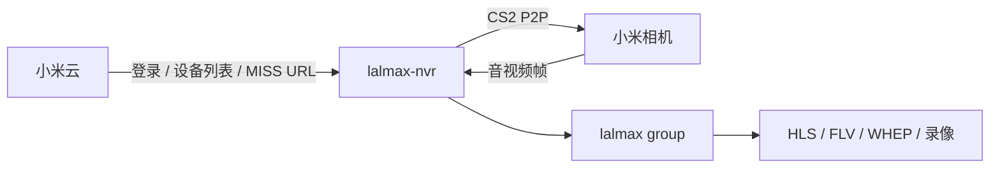
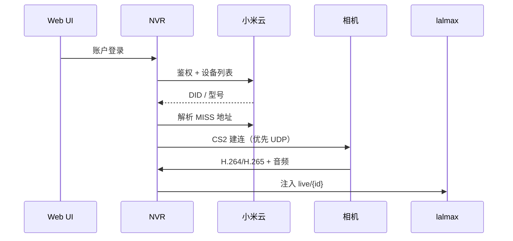

# 小米摄像头设置指南

## 概述

lalmax-nvr 支持通过 CS2 P2P 协议连接小米摄像头。摄像头的视频和音频帧注入 lalmax 后，与其它相机一样走 WebRTC、HLS、HTTP-FLV 等播放。





这是 **P2P 取帧再注入**，不是 RTSP 拉流，也不是 GB28181 推流。总图见 [架构](architecture.md)。

## 前置要求

- 已注册摄像头的小米账户
- 摄像头已绑定到您的小米账户
- 可以访问小米云服务的网络连接

## 支持的型号

| 型号 | 标识符 | 编码 | 音频 | 说明 |
|------|--------|------|------|------|
| 小米 C200 | `chuangmi.camera.046c04` | H264 | PCMA | 1080p 室内摄像头 |
| 小米 C300 | `chuangmi.camera.72ac1` | H265 | Opus | 2K 室内摄像头 |
| 小方摄像头 | `isa.camera.isc5c1` | H264 | PCM | 云台摄像头 |
| 小米 HLC8 | `isa.camera.hlc8` | H265 | PCMA | 双摄摄像头 |
| Loock V2 | `loock.cateye.v02` | H264 | PCMA | 智能门铃 |
| 大方摄像头 | `isa.camera.df3` | - | - | MISS 或旧版固件可尝试，需实机验证 |

**注意**：支持 CS2 和 TUTK 传输的 MISS 设备，并尝试兼容部分旧版设备的登录和视频。旧版设备的 AAC 音频、云台和对讲尚未支持，相关型号和 TUTK 连接仍需实机验证。

## 功能特性

- **实时预览**：支持 WebRTC、HLS、HTTP-FLV 播放
- **录制**：自动 MP4 分段录制
- **音频**：支持 G.711 (PCMA/PCMU) 和 Opus 音频编码
- **音频采样率**：接收 16kHz 的 G.711/PCM 时，先低通滤波并重采样为下游使用的 8kHz；Opus 保持原编码。
- **云台**：支持具备电机的型号进行方向、速度和停止控制。
- **对讲**：支持通过 WebSocket 向摄像头扬声器发送音频
- **双摄设备**：当前使用默认镜头，主/副镜头选择尚未接入配置和界面
- **自动回退**：HD 画质在首视频帧期限内无视频时自动切换到 SD（仅收到音频也会回退）

## 设置步骤

### Web UI 方法（推荐）

1. 打开 NVR Web UI → 摄像头页面
2. 展开"小米设备发现"部分
3. 选择与米家 App 一致的账号地区，输入小米账户凭据
4. 点击"登录"（如需验证码，按提示操作）
5. 从设备列表中选择摄像头
6. 为每个摄像头点击"添加到 NVR"
7. 配置保留策略等设置
8. 保存配置

验证码输入错误或遇到临时网络错误时，可以继续提交当前验证会话；会话在 10 分钟后过期，需要重新登录。凭据只有在成功保存配置后才会对运行中的相机生效，保存失败会显示错误。

账号没有摄像头时仍保持登录。设备刷新失败会显示错误，可继续刷新或退出。点击“退出”会清除服务端保存的账号凭据及未完成的验证码/二次验证会话；清除失败时保留登录状态并提示错误。已有相机配置不会被删除，已经建立的取流连接会持续到断开，后续重连需要重新登录。

### 手动配置

账号相关 API：`GET /api/xiaomi/status` 返回已保存的登录状态和地区，不访问云服务、不返回凭据；`POST /api/xiaomi/logout` 清除凭据及未完成的登录验证，需要管理员权限。

可在配置文件中添加命名账号，再在设备发现面板选择账号：

```yaml
xiaomi:
  user_id: "默认账号用户 ID"
  token: "默认账号令牌"
  region: "cn"
  accounts:
    home:
      user_id: "另一个账号用户 ID"
      token: "另一个账号令牌"
      region: "sg"
```

命名账号当前通过配置文件添加和更新；摄像头地址可使用 `xiaomi://设备ID?account=home` 选择该账号，未指定时沿用默认账号。配置加密启用时，命名账号的用户 ID 和令牌与默认账号凭据一同加密保存。

```yaml
xiaomi:
  user_id: "123456789"
  token: "your_passToken_here"
  region: "cn"

cameras:
  - id: "xiaomi_c200"
    name: "小米 C200"
    protocol: "xiaomi"
    encoding: "h264"
    did: "device_id_here"
    vendor: "cs2"
    enabled: true
    audio_enabled: true
```

**配置字段**：

| 字段 | 必填 | 说明 |
|------|------|------|
| `user_id` | 是 | 小米用户 ID（首次登录后自动获取） |
| `token` | 是 | 小米 passToken（通过登录获取） |
| `region` | 否 | 区域代码，默认 "cn"，支持 "sg"、"de"、"us" 等 |
| `did` | 是 | 设备 ID（从设备发现中获取） |
| `encoding` | 是 | 视频编码，"h264" 或 "h265" |
| `audio_enabled` | 否 | H.264/H.265 设备默认开启音频录制；通过 API 添加时可显式关闭 |

## 云台控制

实时预览中的云台面板提供上下左右和三档速度。按住方向键移动，松开、移出按钮或离开页面时发送停止；小米面板不显示光学变焦或预置位。

云台控制复用正在取流的设备连接。相机未连接或正在重连时，接口返回 `503`。具体型号的电机兼容性需要实机确认。

- `POST /api/cameras/{id}/ptz/move`：`{"mode":"continuous","pan":-0.5,"tilt":0,"zoom":0}`。
- `POST /api/cameras/{id}/ptz/stop`：无需请求体。

`pan`、`tilt` 取值为 `[-1,1]`，分别表示水平和垂直方向；同时设置时使用幅值较大的轴。速度按幅值映射到原生速度 `1–10`，三档对应约 `3/5/10`。全零向量表示停止。仅支持连续移动，变焦向量必须为零。

移动命令的有效期为 2 秒。持续移动的客户端需定期续发命令，Web UI 每 500ms 续发一次；停止请求丢失时，服务端会尝试自动停止。

CW400（`isa.camera.hlc8a`）和 CW500（`isa.camera.500dh`）使用固定步长的云台指令；步长由摄像头决定，速度设置不会改变步长。`GET /api/cameras/{id}/ptz/capabilities` 返回基于型号的控制方式；其他型号返回 `unknown`。该结果不代表设备已验证支持云台，仍需实机测试。

录制器最多缓存云会话 10 分钟、设备列表 30 秒；凭据变化或解析失败会使会话失效，每次连接仍会获取新的设备授权。门铃型号连接前会发送唤醒请求。

摄像头地址可以指定镜头和画质，例如 `xiaomi://123?channel=1&quality=sd`。`channel` 支持 `0`（默认镜头）、`1` 和 `2`；不同型号使用的第二镜头通道可能不同。`quality` 支持 `hd`、`sd` 和 `auto`，默认 `hd`。这些选项目前通过地址配置。

## 对讲功能

小米摄像头支持对讲功能（向摄像头扬声器发送音频）。

### 使用方法

1. 在实时预览页面，点击麦克风按钮
2. 浏览器会请求麦克风权限
3. 授权后即可开始对讲
4. 再次点击停止对讲

### 支持的音频编码

| 摄像头型号 | 对讲编码 |
|-----------|---------|
| 大方、小方 | PCM (16bit) |
| C300 | Opus |
| 其他型号 | PCMA (G.711) |

### API 端点

```
GET /api/xiaomi/talk/ws?camera_id={camera_id}
```

建立 WebSocket 后，先读取服务端的 `connected` 状态和 `speaker_codec`，再发送对应编码的二进制音频。每个消息为一个 40ms 音频包：

- `1027`：8kHz 单声道 PCMA，每包 320 字节。
- `1024`：8kHz 单声道有符号 PCM16LE，每包 640 字节。
- `1032`：48kHz 单声道原始 Opus 包，不包含 WebM/Ogg 容器。

浏览器端按摄像头编码选择编码器；Opus 对讲需要浏览器支持 WebCodecs AudioEncoder，不支持时会显示提示并释放麦克风。

## 网络传输

### 传输协议

小米摄像头使用 CS2 P2P 协议进行通信。系统默认使用 **UDP 传输**。传输层处理相机的 PING/PONG 保活消息。

### 网络要求

- NVR 需要能访问摄像头的局域网 IP
- UDP 端口 32108 需要可达
- 防火墙需要允许 UDP 流量

## 故障排除

### 常见问题

#### "不支持的厂商"错误
- **原因**：摄像头使用尚未支持的传输协议
- **解决方案**：确保您的摄像头型号在支持列表中

#### "认证失败"错误
- **原因**：无效的凭据或账户需要验证码/双因素认证
- **解决方案**：
  - 验证小米账户凭据
  - 按提示完成验证码或手机验证
  - 检查账户是否启用了双因素认证

#### 摄像头未列出
- **原因**：摄像头未绑定到小米账户或离线
- **解决方案**：
  - 确保摄像头在线并连接到小米云
  - 在米家应用中验证摄像头已绑定
  - 检查网络连接

#### 连接后立即断开
- **原因**：CS2 连接问题
- **解决方案**：
  - 确保 NVR 和摄像头在同一局域网
  - 检查 UDP 端口是否被防火墙阻止
  - 查看日志中的具体错误信息

#### WebRTC 无法播放
- **原因**：浏览器不支持 H265 或网络问题
- **解决方案**：
  - 尝试使用 Safari 浏览器（对 H265 支持更好）
  - 检查浏览器控制台是否有错误
  - 尝试切换到 HLS 或 HTTP-FLV 协议

### 日志查看

```bash
# 查看小米相关日志
grep "xiaomi" logs/lalmax-nvr.log

# 查看连接错误
grep "cs2:" logs/lalmax-nvr.log
```

## 技术细节

### 流处理架构

```
小米摄像头 → MISS协议 → H264/H265 + PCMA/Opus
    ↓
CS2 P2P (UDP) → lal 媒体服务器
    ↓
WebRTC / HLS / HTTP-FLV → 浏览器播放
    ↓
RTSP Pull → MP4 录制
```

### 支持的编码

| 类型 | 编码 | 说明 |
|------|------|------|
| 视频 | H.264 | 大部分型号 |
| 视频 | H.265 | C300、HLC8 等新型号 |
| 音频 | G.711 PCMA | 大部分型号 |
| 音频 | G.711 PCMU | 部分型号 |
| 音频 | Opus | C300 等新型号 |

## 有关其他支持

请查看 [快速入门](getting-started.md) 或在 GitHub 仓库中创建问题。
